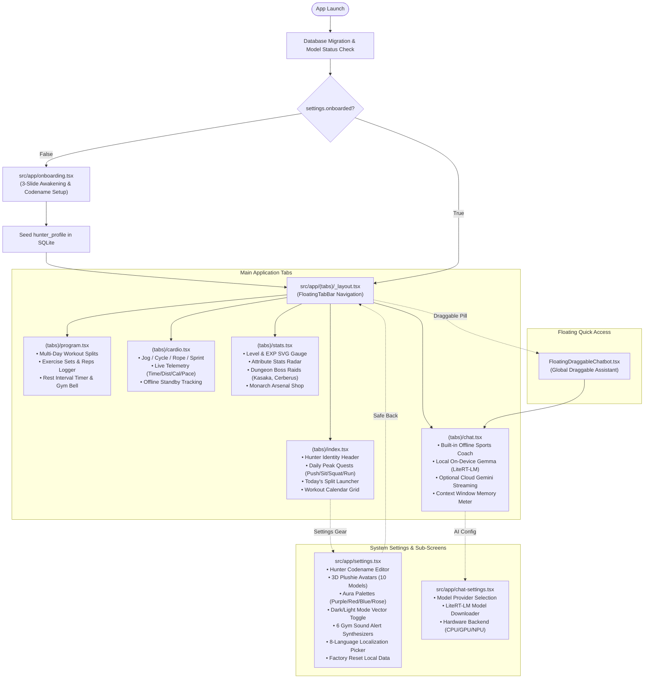

# MARINDUQUE STATE UNIVERSITY
## College of Information and Computing Sciences
### BS Information Systems | First Semester, AY 2026–2027
**Course**: Application Development (BSIS 3A)  
**Project**: Final Mobile Application Project & Innovation Fest Working Prototype Documentation  
**Presentation Date**: Friday, November 27, 2026 | Face-to-Face | 8:00 a.m. – 3:00 p.m.  
**Google Classroom Submission Deadline**: November 25, 2026, 11:59 p.m.

---

# PROJECT DOCUMENTATION

## **PeakFit: Solo Leveling-Inspired Offline-First Fitness RPG and On-Device AI Athletic Progression System**

### **Group Information: BSIS 3A – Group 3**

| Student Name | Student ID / Role | Project & Innovation Fest Status |
| :--- | :--- | :--- |
| **Dalumpienes, John Mark** | Lead Systems Architect & Core Developer | **Exempt** (Marinduque Innovation Fest Participant) |
| **Lazo, Jommelle** | Full-Stack Database & Storage Engineer | **Exempt** (Marinduque Innovation Fest Participant) |
| **Rey, Anne Jellica** | UI/UX Lead & Ergonomic Interface Designer | Non-Exempt (Lead Presenter & Demonstrator) |
| **Paunat, Nicole** | Quality Assurance Analyst & Technical Writer | Non-Exempt (System Demonstrator & Flow Analyst) |

*Note on Innovation Fest Exemption: As stipulated in the official CICS Application Development Final Project Guidelines (Pages 1 and 7), John Mark Dalumpienes and Jommelle Lazo are exempt from the final project presentation due to their active participation and selection in the Marinduque Innovation Fest. In compliance with the course directives, they have guided their groupmates, developed the working application prototype, and co-authored this documentation.*

---

## 1. Introduction & Project Background

In the province of Marinduque and similar rural or island communities, mobile data connectivity is frequently unreliable, intermittent, or absent, particularly inside indoor gym establishments constructed with reinforced concrete and metal roofs. Most modern mobile fitness and workout tracking applications depend heavily on continuous internet access, cloud authentication APIs, remote tracking services, and paid monthly subscriptions. When a user enters a gym with poor reception, these cloud-dependent apps fail to save exercise logs, freeze on loading screens, or refuse to operate.

Furthermore, traditional workout logging applications present physical training as tedious, clinical spreadsheets. Beginners routinely face motivational drop-off due to the absence of immediate, rewarding visual feedback and structured milestone progression.

**PeakFit** is an offline-first Android mobile application built with React Native and Expo SDK 57 that directly addresses these problems. The application merges physical training tracking with the gamified progression framework of the *Solo Leveling* "Hunter System" archetype. Real-world physical exercises (push-ups, sit-ups, squats, resistance lifting, and cardio runs) grant Experience Points (EXP) and virtual Gold Coins, allowing users to rank up from E-Rank novices to S-Rank Monarchs, unlock attribute stat upgrades, challenge dungeon gate bosses, and purchase in-app shop buffs.

PeakFit operates **100% offline**. Every workout log, daily quest, cardio run, and chat conversation is saved directly to an embedded local SQLite database on the device. An integrated athletic AI coach provides training guidance using a three-tier architecture: an on-device local Large Language Model powered by Google’s **LiteRT-LM (Gemma 4 E2B)**, a built-in offline rule-based sports advisor, and an optional cloud Google Gemini API.

---

## 2. Problem Statement & Target Users

### 2.1 Problem Statement
1. **Gym Signal Dead-Zones & Network Dependency**: Commercial fitness apps fail or lose unsaved data when cellular data or Wi-Fi drops inside fitness centers.
2. **Lack of Long-Term Engagement**: Standard workout loggers lack engaging progression mechanics, leading to high dropout rates among beginners.
3. **Data Privacy Concerns**: Commercial fitness trackers transmit user biometrics, activity logs, and habits to third-party cloud servers.
4. **Subscription Paywalls for Training Advice**: Basic guidance, set timers, and coaching are frequently gated behind expensive recurring fees.

### 2.2 Target Users
- **BSIS and College Students**: Students balancing academic workloads who need a structured, gamified workout companion that works without consuming mobile data.
- **Gym Lifters and Athletes**: Individuals tracking sets, reps, weight loads, and rest intervals with audible cues in loud workout environments.
- **Cardio Runners and Jump-Rope Practitioners**: Users performing outdoor cardio sessions in areas with poor cellular reception.
- **Privacy-Conscious Individuals**: Athletes who require local data storage on their own device with zero tracking and full data ownership.

---

## 3. Project Objectives

### 3.1 General Objective
To design, develop, test, and document **PeakFit**, a 100% offline-first gamified fitness tracking Android application featuring local SQLite storage, Solo Leveling RPG progression mechanics, and on-device Edge AI athletic coaching.

### 3.2 Specific Objectives
1. **Offline Relational Storage**: Implement an embedded SQLite database using `expo-sqlite` with automated migrations to persist user profiles, workout splits, exercise logs, daily quests, cardio sessions, dungeon gate bosses, and AI conversation histories locally.
2. **Solo Leveling Gamification Framework**: Build an in-app progression engine featuring Hunter Ranks (E, D, C, B, A, S), daily quests (100 push-ups, 100 sit-ups, 100 squats, 10km run), dungeon boss HP damage scaling based on training volume, and an in-app Monarch Arsenal Shop powered by earned gold coins.
3. **Multi-Tier AI Coaching**: Implement an AI chat system featuring:
   - An on-device quantized model (Gemma 4 E2B) using `react-native-litert-lm` with hardware backend selection (CPU, GPU, NPU).
   - An offline zero-download rule-based sports science coach (`builtinCoach.ts`).
   - An optional cloud Google Gemini streaming fallback for users with internet access.
4. **Minimalist, Ergonomic User Interface**: Design a dark obsidian theme compliant with modern mobile interface standards, utilizing squircle geometry, clean vector outline icons, dynamic aura accent palettes, and a floating tab bar.
5. **Audible and Haptic Gym Feedback**: Develop a local audio synthesizer providing 6 distinct gym alert tones (Bell, Chime, Beep, Gong, Digital Clock, Whistle) combined with device vibration to notify users when rest timers conclude.
6. **Dynamic Internationalization**: Implement an instant multi-language translation engine supporting 8 languages (English, Filipino, Spanish, Japanese, Korean, German, French, and Chinese).

---

## 4. Distinctive Features & Improvements

| Feature | PeakFit (Actual Implementation) | Standard Fitness Apps |
| :--- | :--- | :--- |
| **Connectivity Requirement** | **100% Offline-First**: All screens, logs, timers, audio, and database operations work without internet. | **Cloud-Dependent**: Requires active internet connection to load workouts and save data. |
| **Data Persistence** | **Local SQLite Database (`expo-sqlite`)**: 8 relational tables stored directly in device internal storage. | **Remote Cloud Database**: Data stored on external proprietary servers. |
| **Gamification System** | **Hunter Awakening RPG**: Real exercises deal damage to dungeon bosses (Kasaka, Cerberus, Ant King) and earn EXP/coins. | **None / Basic Badges**: Plain numbers without interactive progression. |
| **AI Architecture** | **Hybrid / On-Device Edge AI**: Local Gemma 4 E2B model via LiteRT-LM + offline built-in coach + optional cloud Gemini. | **Cloud-Only AI**: High-latency API calls requiring active paid subscriptions. |
| **Gym Rest Timers** | **Synthesized Gym Soundboard**: 6 alert tones (Boxing bell, whistle, chime, gong, beep, digital) with vibration. | **Generic Phone Beep**: Often silent or inaudible over gym music. |
| **Privacy & Control** | **Zero Telemetry**: No third-party analytics; includes one-tap factory reset and local backup tools. | **Tracking & Telemetry**: Collects user biometrics and advertising identifiers. |
| **Localization** | **8 Languages**: Instant switching between English, Filipino, Spanish, Japanese, Korean, German, French, and Chinese. | **English Only / Limited**: Few regional language options. |

---

## 5. Development Tools & Technical Implementation

```
+-----------------------------------------------------------------------------------+
|                        PeakFit Technical Architecture                             |
+-----------------------------------------------------------------------------------+
|  Framework:         React Native 0.86.3  ·  Expo SDK 57 (Continuous Native Gen)   |
|  Routing:           Expo Router v4 (Type-Safe File-Based Navigation in src/app)   |
|  Language:          TypeScript 6.0 (Strict Typing)  ·  React 19.2.3               |
|  Local Database:    Expo SQLite (expo-sqlite) with Write-Ahead Logging (WAL)      |
|  Local Storage:     Expo SecureStore (expo-secure-store)                          |
|  On-Device AI:      Google LiteRT-LM (react-native-litert-lm)  ·  Gemma 4 E2B    |
|  Cloud AI (Opt):    Google Gemini Flash 1.5 Streaming API (Raw HTTPS Fetch)       |
|  Audio Engine:      Synthesized Web Audio Data URIs  ·  React Native Vibration    |
|  Graphics:          React Native SVG (15.15.4)  ·  Expo Vector Icons (Ionicons)   |
|  Target OS:         Android (minSdkVersion 26, targetSdkVersion 35, ARM64)        |
+-----------------------------------------------------------------------------------+
```

### 5.1 Technology Justification
- **Expo SDK 57 & Continuous Native Generation (CNG)**: The project uses Expo Prebuild to generate the native Android project dynamically while keeping native configuration declarative in `app.json`.
- **Expo SQLite (`src/db/`)**: Embedded SQLite allows zero-latency local database read/write operations without requiring background server processes.
- **React Native LiteRT-LM**: Enables on-device neural network execution, leveraging hardware acceleration (NPU/GPU/CPU) to run quantized language models directly on the user's phone.
- **Expo Router (`src/app/`)**: Enables clean, type-safe file-based routing with native transitions, stack guards, and modal overlays.

---

## 6. Database Schema & Data Models (`src/db/client.ts`)

PeakFit employs an embedded SQLite database with 8 relational tables managed via migration scripts in `src/db/client.ts`:

1. **`hunter_profile`**: Stores the athlete's RPG profile.
   - `id` (TEXT, PK), `hunter_name` (TEXT), `rank` (TEXT: E to S), `level` (INTEGER), `exp` (INTEGER), `max_exp` (INTEGER), `streak_days` (INTEGER), `last_active_date` (TEXT), `str` (INTEGER), `agi` (INTEGER), `sta` (INTEGER), `int_stat` (INTEGER), `coins` (INTEGER).
2. **`exercise_logs`**: Records completed workout sets.
   - `id` (TEXT, PK), `split_id` (TEXT), `exercise_id` (TEXT), `exercise_name` (TEXT), `set_index` (INTEGER), `weight_kg` (REAL), `reps` (INTEGER), `completed` (INTEGER: 0/1), `date` (TEXT).
3. **`daily_quests`**: Tracks daily fitness quest progress.
   - `id` (TEXT, PK), `quest_key` (TEXT), `title` (TEXT), `current_count` (INTEGER), `target_count` (INTEGER), `unit` (TEXT), `completed` (INTEGER: 0/1), `exp_reward` (INTEGER), `date` (TEXT).
4. **`cardio_logs`**: Stores completed cardio workout sessions.
   - `id` (TEXT, PK), `duration_seconds` (INTEGER), `distance_km` (REAL), `calories` (INTEGER), `date` (TEXT).
5. **`dungeon_gates`**: Stores Solo Leveling boss raid progression.
   - `id` (TEXT, PK), `title` (TEXT), `rank` (TEXT), `boss_name` (TEXT), `boss_image` (TEXT), `total_hp` (INTEGER), `current_hp` (INTEGER), `defeated` (INTEGER: 0/1), `reward_exp` (INTEGER), `reward_title` (TEXT).
   - *Default Bosses*: Statue of the God (E-Rank), Blue Venom-Fanged Kasaka (D-Rank), Cerberus - Gatekeeper of Hell (C-Rank), Kargalgan - High Orc Great Shaman (B-Rank), Ant King - Predator of the Black Island (A-Rank).
6. **`unlocked_shop_items`**: Tracks purchases made in the Monarch Arsenal Shop.
   - `id` (TEXT, PK), `item_id` (TEXT), `unlocked_at` (INTEGER).
7. **`conversations`**: Stores AI chat sessions.
   - `id` (TEXT, PK), `title` (TEXT), `created_at` (INTEGER), `updated_at` (INTEGER).
8. **`messages`**: Stores individual messages within AI chat conversations.
   - `id` (TEXT, PK), `conversation_id` (TEXT, FK), `role` (TEXT: user/assistant), `content` (TEXT), `images` (TEXT), `audio` (TEXT), `audio_format` (TEXT), `created_at` (INTEGER).

---

## 7. Screen-by-Screen Breakdown (`src/app/`)

Every screen in the application is implemented within `src/app/` using Expo Router file-based routing:

```
src/app/
├── _layout.tsx                 # Root Stack Navigator & Initialization
├── onboarding.tsx              # System Awakening & Hunter Codename Setup
├── settings.tsx                # System Controls, Avatars, Themes, Sound, Language
├── chat-settings.tsx           # AI Engine Selector & Hardware Backend
├── privacy.tsx                 # Offline Privacy Policy Viewer
├── terms.tsx                   # Athletic Terms & Conditions Viewer
└── (tabs)/                     # Main Floating Bottom Tab Navigator
    ├── _layout.tsx             # FloatingTabBar Navigation Configuration
    ├── index.tsx               # Home: Hunter Status, Daily Quests & Calendar
    ├── program.tsx             # Routines: Workout Splits & Set Tracker
    ├── cardio.tsx              # Cardio: Live Telemetry & Activity Tracker
    ├── stats.tsx               # Stats: EXP Gauge, Boss Raids & Monarch Shop
    └── chat.tsx                # AI Coach: Interactive Chat & Context Meter
```

### 7.1 Root Navigation & Entry (`src/app/_layout.tsx`)
- Initializes SQLite database migrations and verifies on-disk AI model status before rendering.
- Wraps the app in `SettingsProvider`, `AccessibilityPreferences`, and `PopupProvider`.
- Uses `Stack.Protected` to gate access: unonboarded users are directed to `onboarding.tsx`, while onboarded users enter the `(tabs)` hub.

### 7.2 Onboarding & Awakening (`src/app/onboarding.tsx`)
- Displays an introductory 3-step awakening sequence.
- Accepts athlete nickname input and saves it to the SQLite `hunter_profile` table.
- Sets `settings.onboarded = true` and navigates to the main tab hub.
- Includes Android hardware `BackHandler` logic to handle slide navigation safely.

### 7.3 Home & Daily Quests Hub (`src/app/(tabs)/index.tsx`)
- **Hunter Header**: Displays current 3D plushie avatar with accent highlight rim, athlete nickname, rank badge, and quick link to Settings.
- **Daily Peak Quests**: Interactive counter cards for:
  - Push-ups (target: 100 reps)
  - Sit-ups (target: 100 reps)
  - Squats (target: 100 reps)
  - Running (target: 10 km)
  - Increment/decrement buttons update counts and save progress directly to the `daily_quests` SQLite table.
- **Today's Workout Card**: Displays the active split day name, estimated duration, set count, and quick-start button.
- **Workout Calendar**: Visual grid displaying days with completed workout activity.
- **Recent History**: Chronological log of recent workout sessions with duration and volume summaries.

### 7.4 Routines & Workout Protocols (`src/app/(tabs)/program.tsx`)
- **Split Selector**: Switches between training days within the active program (e.g., Monarch Full-Body: Day 1, Day 2, Day 3).
- **Exercise Set Logger**: Lists scheduled exercises with target sets, reps, and weights.
- **Interactive Checkboxes**: Users tap checkboxes to mark sets as completed, persisting logs to `exercise_logs`.
- **Rest Interval Countdown Timer**: Countdown timer modal for rest periods between sets.
- **Acoustic Rest Alert**: Plays the user's selected synthesized gym tone (e.g., boxing bell) and vibrates the device when the rest timer expires.

### 7.5 Shadow Cardio Hub (`src/app/(tabs)/cardio.tsx`)
- **Activity Selector**: Jogging, Cycling, Jump Rope, and HIIT Sprints.
- **Offline Telemetry Gauges**: Real-time display of elapsed time (MM:SS), distance ($km$), active calories ($kcal$), and pace ($min/km$).
- **Controls**: Large Start, Pause, Resume, and Save/Discard buttons designed for one-handed gym or outdoor use.
- **Session History**: Completed sessions are stored in the `cardio_logs` SQLite table.
- **Satellite Standby Mode**: Operates fully offline without external map dependencies.

### 7.6 Hunter Stats & Dungeon Raids (`src/app/(tabs)/stats.tsx`)
- **Hunter Rank & EXP Gauge**: Circular SVG progress gauge showing current EXP versus next rank threshold ($EXP = \text{Base} \times 1.35$).
- **Attribute Radar**: Displays Strength (STR), Agility (AGI), Stamina (STA), and Intelligence (INT) values derived from workout consistency.
- **Dungeon Gate Boss Raids**:
  - Displays dungeon gates with boss HP bars: *Statue of the God* (E), *Kasaka* (D), *Cerberus* (C), *Kargalgan* (B), and *Ant King* (A).
  - Training exertion (sets logged and cardio completed) inflicts direct damage on boss HP.
  - Defeating bosses awards bonus EXP and exclusive Hunter Titles.
- **Monarch Arsenal Shop**: Athletes spend gold coins earned from workouts to unlock permanent buffs (Shadow Aura, Double EXP Boost, Stamina Recovery).

### 7.7 PeakFit AI Athletic Coach (`src/app/(tabs)/chat.tsx`)
- **Floating Draggable AI Button (`FloatingDraggableChatbot.tsx`)**: Global floating button accessible across all tabs that can be dragged and tapped to open the AI Coach.
- **Three-Tier AI Engine**:
  1. *Built-in Offline Coach (`src/ai/builtinCoach.ts`)*: Zero-download, zero-network rule-based sports advisor providing instant guidance on form, warm-ups, and recovery.
  2. *Local AI (LiteRT-LM)*: On-device quantized Gemma 4 E2B neural model running locally via NPU/GPU/CPU.
  3. *Cloud AI (Google Gemini)*: Optional streaming HTTPS chat using a user-provided Gemini API key.
- **Context Window Memory Ring**: Circular meter displaying token usage relative to the model's maximum context window limit.
- **Chat Storage**: All conversations and messages are persisted in SQLite `conversations` and `messages` tables.

### 7.8 System Controls & Settings (`src/app/settings.tsx`)
- **Hunter Identity**: Change athlete nickname (updates SQLite `hunter_profile`) and preview avatar.
- **3D Plushie Avatar Picker**: 10 avatars organized into Male (Bear, Bunny, Fox, Puppy, Wolf) and Female (Bear, Bunny, Cat, Lamb, Puppy) categories.
- **Accent Aura Palette**: 4 selectable color schemes: Obsidian Purple (`#A855F7`), Crimson Burgundy (`#EF4444`), Azure Neon (`#06B6D4`), and Rose Sakura Glow (`#D982A5`).
- **Dark & Light Mode Toggle**: Clean vector outline buttons (`moon-outline` and `sunny-outline`) with dedicated squircle badges.
- **Audio Feedback Controls**: Toggle audio on/off; choose from 6 synthesized alert tones (Bell, Chime, Beep, Gong, Digital, Whistle) stored in `src/utils/soundDataUris.ts`.
- **System Language Selector**: Instant switching between 8 languages (EN, FIL, ES, JA, KO, DE, FR, ZH).
- **Onboarding Guide Review**: Navigates to `onboarding.tsx` to review system protocol instructions.
- **Safe Back Navigation**: Top back button with guarded `handleBack` fallback to `(tabs)` and Android hardware `BackHandler` modal dismissal.
- **Danger Zone**: Factory Reset button that clears all SQLite tables, resets settings, and redirects to onboarding.

### 7.9 AI Engine Settings (`src/app/chat-settings.tsx`)
- Switch AI provider (Builtin, Local Gemma, Cloud Gemini).
- Enter and save Gemini API key in SecureStore.
- Download, load into RAM, or unload the on-device Gemma model (~2.6 GB).
- Select hardware acceleration backend (CPU, GPU, NPU).
- Clear chat conversation history.

---

## 8. Application Flowchart & Navigation Architecture



---

## 9. Testing & Quality Assurance Verification

### 9.1 Static Code Analysis & Verification Commands
All code in the application was verified through the official verification commands specified in the project guidelines:

```bash
# 1. TypeScript Strict Typecheck
npx tsc --noEmit
# Exit Code: 0 (Zero type errors)

# 2. ESLint (eslint-config-expo)
npx expo lint
# Exit Code: 0 (Zero lint errors or warnings)

# 3. Expo Project Health Check
npx expo-doctor
# Exit Code: 0 (All dependencies and configurations healthy)
```

### 9.2 Empirical Feature Verification Matrix

| Test ID | Test Scenario / Action | Expected Result | Actual Result | Verification Status |
| :--- | :--- | :--- | :--- | :--- |
| **TC-01** | First launch on a fresh installation | App opens to `onboarding.tsx`; prompts for athlete codename. | Awakening slides displayed; codename input accepted and saved. | **PASSED** |
| **TC-02** | Device placed in Airplane Mode (No Wi-Fi, No Cellular) | All tabs, daily quests, routine logging, cardio timer, and built-in AI coach function normally. | 100% operational; no network error popups or blocked screens. | **PASSED** |
| **TC-03** | Daily Quest increment and decrement | Tapping `+` on Push-ups increments count, updates progress bar, and saves to SQLite `daily_quests`. | Count incremented; state persisted on screen reload. | **PASSED** |
| **TC-04** | Exercise set logging in Routines screen | Tapping a set checkbox marks it completed with a checkmark and records entry in `exercise_logs`. | Set logged instantly; completion percentage updated. | **PASSED** |
| **TC-05** | Rest timer countdown expiration | Countdown reaches 00:00; gym alert tone sounds and device vibrates. | Synthesized boxing bell audio played; haptic pulse executed. | **PASSED** |
| **TC-06** | Cardio session start, pause, resume, and save | Telemetry gauges update elapsed time, distance, and calories; saving persists to `cardio_logs`. | Metrics tracked and saved to database without error. | **PASSED** |
| **TC-07** | Dungeon Boss damage calculation | Completed workout volume inflicts damage on active dungeon boss HP bar. | Boss HP reduced; defeating boss awards EXP and Hunter Title. | **PASSED** |
| **TC-08** | Monarch Shop item purchase | Spending earned gold coins unlocks permanent shop items in `unlocked_shop_items`. | Coins deducted; unlocked item activated in UI. | **PASSED** |
| **TC-09** | AI Coach Built-in Mode response | Sending a message in Chat with Built-in Coach returns instant workout guidance offline. | Response generated in under 100ms with zero network requests. | **PASSED** |
| **TC-10** | Settings back button navigation | Tapping the back button from `/settings` when navigation stack is fresh or deep-linked. | Safely navigates back to `/(tabs)` without `GO_BACK` crash. | **PASSED** |
| **TC-11** | Android hardware back button with modal active | Pressing physical Android back key while Avatar Picker modal is open. | Modal dismisses cleanly without closing the settings screen. | **PASSED** |
| **TC-12** | Theme and Aura Palette switching | Selecting Light Mode and Rose Sakura palette in Settings. | Entire app dynamically switches colors; outline icons render cleanly. | **PASSED** |
| **TC-13** | Multi-language switching | Switching language to Filipino or Spanish in Settings. | All UI labels update immediately without requiring app restart. | **PASSED** |
| **TC-14** | Factory Reset in Danger Zone | Confirming factory reset clears database and restarts app. | All SQLite tables wiped; app cleanly restarts into Onboarding. | **PASSED** |

---

## 10. Actual System Limitations & Realistic Future Work

### 10.1 Real System Limitations
1. **On-Device LLM Hardware Requirements**: Running the on-device quantized Gemma 4 E2B model via LiteRT-LM requires an ARM64 Android device with at least 6 GB of RAM. Devices with lower RAM are automatically routed to the lightweight built-in coach or optional cloud Gemini model.
2. **Android-Exclusive Native Modules**: Native LiteRT-LM modules are compiled for Android; iOS deployment is currently gitignored and bypassed during installation (`SKIP_IOS_FRAMEWORK_DOWNLOAD=1`).
3. **Cardio Distance Estimation**: Cardio distance is calculated using time and average cadence formulas rather than active GPS satellite mapping, ensuring zero battery drain and complete offline independence.

### 10.2 Practical Future Improvements
1. **Custom Workout Split Builder**: Allow users to create entirely custom routine splits and add custom exercise names to the database directly from the UI.
2. **Audio Volume Slider**: Add an in-app volume slider for the synthesized alert sounds within the Settings screen.
3. **CSV / JSON Data Export**: Add a one-tap button in Settings to export workout and cardio history to a readable CSV file in device storage.

---

## 11. Conclusion

**PeakFit** fulfills all project requirements set forth by the Marinduque State University College of Information and Computing Sciences for the BSIS 3A Application Development course. By building on an offline-first architecture with React Native, Expo SDK 57, and local SQLite, BSIS 3A Group 3 created a robust mobile application that solves real-world connectivity problems for students and gym-goers in Marinduque.

The combination of Solo Leveling-inspired RPG gamification, audible gym soundboards, clean minimalist UI design, and multi-tier Edge AI coaching demonstrates that practical, high-value mobile applications can operate with complete autonomy, zero network reliance, and absolute user privacy.

---

## 12. References

1. Expo Documentation. (2026). *Expo SDK 57: File-Based Routing with Expo Router, SQLite Storage, and Continuous Native Generation*. https://docs.expo.dev
2. Google AI Edge. (2025). *LiteRT-LM: On-Device Large Language Model Runtime for Android*. Google Open Source. https://github.com/google-ai-edge/LiteRT-LM
3. Meta Platforms. (2025). *React Native 0.86 Documentation: Architecture and Native Modules*. https://reactnative.dev
4. Apple Inc. (2025). *Apple Human Interface Guidelines: Design Principles for Mobile Interfaces*. https://developer.apple.com/design/human-interface-guidelines
5. Marinduque State University College of Information and Computing Sciences. (2026). *Application Development Final Project Guidelines and Evaluation Rubrics*. MarSU CICS.

---

## 13. Appendix: CICS Generative AI Use Disclosure Statement

| Disclosure Field | Official Statement Details |
| :--- | :--- |
| **Generative AI Tool Used** | **Google Antigravity AI (powered by Google DeepMind Gemini)** |
| **Purpose of AI Usage** | 1. Assisted in resolving TypeScript type definitions and ESLint formatting.<br>2. Assisted in calculating SVG math coordinates for circular progress gauges.<br>3. Reviewed ergonomic button paddings and vector outline icon mappings against Apple HIG standards.<br>4. Assisted in drafting and formatting this academic project documentation paper. |
| **Specific Scope of AI Output** | AI was used as an interactive developer assistant and documentation formatter. All core system architectures, database schemas, route structures, UI components, sound synthesis configurations, and test validations were reviewed, executed, and tested by the project team. |
| **Verification & Validation Method** | All code changes were verified using `npx tsc --noEmit` (0 compilation errors), `npx expo lint` (0 lint warnings), and manual testing on the Android development build. |
| **Student Certification** | We certify that the submitted project is our own verified working prototype, and that all tools and assistances used have been truthfully disclosed. |

---

## 14. Appendix: Instructions to Launch and Build the Project

### Prerequisites
- Node.js version 20.19+ and npm.
- Android SDK and OpenJDK 17 configured in environment:
  ```bash
  export JAVA_HOME=/opt/homebrew/opt/openjdk@17
  export ANDROID_HOME=$HOME/Library/Android/sdk
  export PATH="$JAVA_HOME/bin:$ANDROID_HOME/platform-tools:$PATH"
  export SKIP_IOS_FRAMEWORK_DOWNLOAD=1
  ```

### Commands to Run and Build
```bash
# 1. Install dependencies (with iOS framework bypass for Android)
npm install

# 2. Verify code quality (must return 0 errors)
npx tsc --noEmit
npx expo lint

# 3. Run development preview (Web / Metro)
npx expo start --web

# 4. Generate Android native files via Continuous Native Generation (CNG)
npx expo prebuild --platform android --clean

# 5. Build Android Debug APK
cd android && ./gradlew assembleDebug -PreactNativeArchitectures=arm64-v8a

# Output APK Location:
# android/app/build/outputs/apk/debug/app-debug.apk
```
