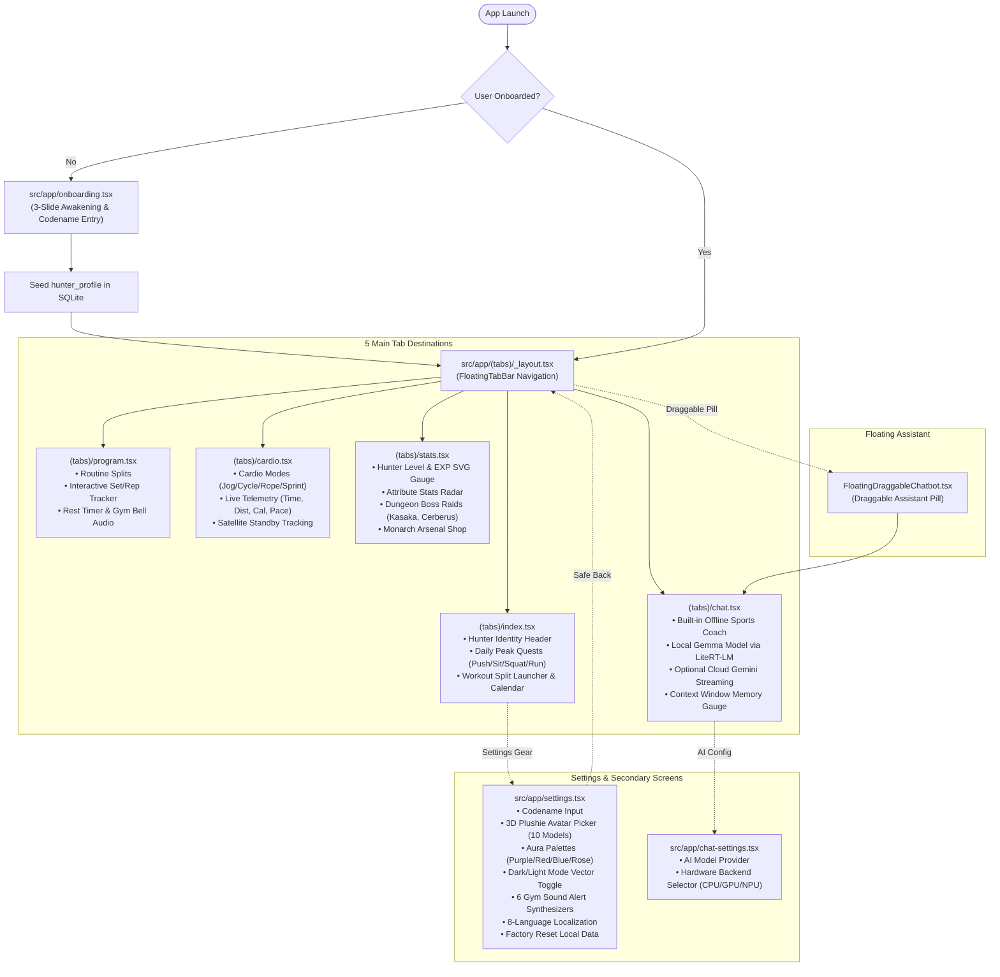

# MARINDUQUE STATE UNIVERSITY
## College of Information and Computing Sciences
### Bachelor of Science in Information Systems (BSIS 3A)
**First Semester, Academic Year 2026–2027**  
**Course Code & Title**: Application Development Final Project  
**Submission Deadline**: November 25, 2026, 11:59 PM (Google Classroom)  
**Presentation Date**: Friday, November 27, 2026 | Face-to-Face | 8:00 AM – 3:00 PM  
**Group Designation**: **BSIS 3A – Group 3**

---

# FINAL PROJECT COMPILATION & SUBMISSION PACK

---

## FOLDER DELIVERABLE 1: WORKING APPLICATION (GUMAGANANG APPLICATION)

### 1.1 Application Package & Build Identity
- **Application Name**: PeakFit
- **Package Name (Android)**: `com.peakfit.app`
- **Application Version**: `1.0.0`
- **Target Platform**: Android (Physical Device or Android Emulator)
- **Primary Deliverable File**: `android/app/build/outputs/apk/debug/app-debug.apk`
- **Development Access Preview**: `http://localhost:8081` (via `npx expo start --web` or Metro bundler)

### 1.2 System & Hardware Requirements
| Component | Minimum Specification | Recommended Specification |
| :--- | :--- | :--- |
| **Operating System** | Android 8.0 (API Level 26 - Oreo) | Android 12.0 – Android 15.0 (API 31–35) |
| **Processor Architecture** | 64-bit ARM (`arm64-v8a`) | 64-bit ARM (`arm64-v8a`) with dedicated NPU/GPU |
| **Random Access Memory (RAM)** | 4 GB Total RAM (Built-in Coach mode) | 6 GB to 8 GB+ RAM (For on-device Gemma LiteRT-LM model) |
| **Internal Storage** | 150 MB free space (Base APK & SQLite database) | 3.5 GB free space (If downloading local Gemma 4 E2B model) |
| **Network Connectivity** | **Zero Internet Required (100% Offline-First)** | Optional Wi-Fi (Only if downloading local model or using Cloud Gemini) |

### 1.3 Step-by-Step Installation Instructions on Android
1. **Copy the APK**: Transfer `app-debug.apk` to your Android phone via USB cable, Google Drive, or local storage.
2. **Enable Unknown Sources**: In Android Settings, navigate to *Security* > *Install unknown apps* and permit your file browser to install APKs.
3. **Install**: Tap `app-debug.apk` and press **Install**.
4. **Launch**: Open **PeakFit** from your app drawer.
5. **Initial Setup**: The app opens directly to the 3-step *System Awakening* onboarding. Enter your athlete codename (e.g., "Hunter" or your name) and tap **Start Your Prime**.
6. **Offline Usage**: You can immediately enable **Airplane Mode**; all tabs, routines, cardio telemetry, sound effects, and the built-in coach will operate without interruption.

---

## FOLDER DELIVERABLE 2: COMPLETE SOURCE CODE & SETUP GUIDE (KUMPLETONG SOURCE CODE)

### 2.1 Project File Structure Overview
The complete source code is located in the project root directory and structured as follows:

```
appdev_boilerplate_copy/
├── android/                     # Generated Android Native Project (Continuous Native Generation)
├── assets/                      # Application Assets
│   ├── images/                  # App icons, splash screens, gym wallpaper
│   │   └── avatars/             # 10 3D Plushie Avatar JPEG images (5 Male, 5 Female)
│   └── sounds/                  # Synthesized gym alert sound data
├── docs/                        # Project Documentation & Architecture Guides
│   ├── FINAL-PROJECT-SUBMISSION.md
│   ├── ARCHITECTURE.md
│   └── PROJECT-OVERVIEW.md
├── src/
│   ├── ai/                      # AI Engine (LiteRT-LM, Gemini Client, Builtin Coach)
│   ├── app/                     # Expo Router Navigation & Screen Directory
│   │   ├── _layout.tsx          # Root Stack, Database Migrations, Protected Route Gate
│   │   ├── onboarding.tsx       # 3-Slide System Protocol Awakening & Codename Entry
│   │   ├── settings.tsx         # System Controls, Avatars, Aura Themes, Alert Tones, Language
│   │   ├── chat-settings.tsx    # AI Engine Provider Selector & Hardware Backend Manager
│   │   ├── privacy.tsx          # 100% Offline Architecture Privacy Policy Screen
│   │   ├── terms.tsx            # Athletic Progression & Safety Terms
│   │   └── (tabs)/              # Persistent 5-Tab Navigation Matrix
│   │       ├── _layout.tsx      # Custom Floating iOS Squircle Tab Bar Configuration
│   │       ├── index.tsx        # Home: Daily Quests, Split Launcher, Workout Calendar
│   │       ├── program.tsx      # Routines: Workout Splits, Interactive Set/Rep Tracker
│   │       ├── cardio.tsx       # Cardio Hub: Multi-Activity Telemetry & Offline Standby
│   │       ├── stats.tsx        # Stats: EXP Gauge, Attributes Radar, Boss Raids, Shop
│   │       └── chat.tsx         # AI Coach: Interactive Sports Advisor & Memory Meter
│   ├── components/              # Ergonomic UI Components (FloatingTabBar, Draggable Pill, Modals)
│   ├── db/                      # SQLite Schema Migrations & Hunter Profile Relational Operations
│   ├── i18n/                    # 8-Language Translation Engine (EN, FIL, ES, JA, KO, DE, FR, ZH)
│   ├── legal/                   # Static Privacy and Terms Policy Text
│   ├── settings/                # Settings Context & Storage Management
│   ├── theme.ts                 # Obsidian Dark/Light Mode Tokens & 4 Aura Accent Palettes
│   └── utils/                   # Synthesized Gym Soundboards, Avatar Options, Math Helpers
├── app.json                     # Expo Application Configuration & Android Build Properties
├── package.json                 # Project Dependencies & NPM Scripts
├── tsconfig.json                # TypeScript Strict Configuration
└── AGENTS.md                    # Environment & Verification Standards
```

### 2.2 Required Software
- **Node.js**: Version 20.19.0 or higher
- **NPM**: Version 10.0.0 or higher
- **Java Development Kit**: OpenJDK 17
- **Android SDK**: Build-Tools 35.0.0, Platform API 35 (Android 15)

### 2.3 Dependencies (`package.json`)
- **Core Framework**: `react` (19.2.3), `react-native` (0.86.3), `expo` (~57.0.32), `expo-router` (~57.0.30)
- **Database & Storage**: `expo-sqlite` (~57.0.4), `expo-secure-store` (~57.0.4)
- **Local On-Device AI**: `react-native-litert-lm` (^0.7.0), `react-native-nitro-modules` (^0.37.1)
- **Graphics & Vectors**: `react-native-svg` (15.15.4), `@expo/vector-icons` (^15.0.2)
- **Audio & Sensory**: `expo-audio` (~57.0.5), Web Audio API Data URIs, React Native `Vibration`
- **UI & Layout**: `react-native-safe-area-context` (~5.7.0), `react-native-screens` (~4.26.0), `expo-blur` (~57.0.3)

### 2.4 Setup & Build Commands
```bash
# 1. Environment configuration (Terminal / PowerShell)
export SKIP_IOS_FRAMEWORK_DOWNLOAD=1

# 2. Install all required dependencies
npm install

# 3. Verify static code quality (Zero errors required)
npx tsc --noEmit
npx expo lint

# 4. Run application in development preview mode
npx expo start --web

# 5. Generate clean Android native project (CNG)
npx expo prebuild --platform android --clean

# 6. Assemble local debug APK (ARM64 architecture)
cd android && ./gradlew assembleDebug -PreactNativeArchitectures=arm64-v8a
```

### 2.5 Security & Credentials Statement
No passwords, API keys, private tokens, or hardcoded personal credentials are included in this source code. The Google Gemini API key field in `src/app/chat-settings.tsx` is left empty by default and is only populated if the user voluntarily inputs their own private key, which is saved strictly to the phone's local `expo-secure-store`.

---

## FOLDER DELIVERABLE 3: PROJECT DOCUMENTATION PAPER (DOKUMENTASYON NG PROJECT)

### 3.1 Application Title & Group Members
- **Application Title**: **PeakFit: Solo Leveling-Inspired Offline-First Fitness RPG and On-Device AI Athletic Progression System**
- **Course & Section**: BSIS 3A | First Semester, AY 2026–2027
- **Institution**: College of Information and Computing Sciences, Marinduque State University (MarSU)
- **Group Members**:
  1. **Dalumpienes, John Mark** — Lead Systems Architect & Core Developer (*Exempt – Marinduque Innovation Fest Participant*)
  2. **Lazo, Jommelle** — Full-Stack Database & Storage Engineer (*Exempt – Marinduque Innovation Fest Participant*)
  3. **Rey, Anne Jellica** — UI/UX Lead & Ergonomic Interface Designer (*Lead Presenter*)
  4. **Paunat, Nicole** — Quality Assurance Analyst & Technical Writer (*System Demonstrator*)

### 3.2 Introduction
In collegiate and rural environments such as Marinduque, student-athletes and gym-goers frequently exercise in concrete facilities or outdoor locations where cellular data reception is weak or non-existent. Standard mobile workout trackers rely heavily on continuous cloud connectivity, user tracking telemetry, and monthly subscription paywalls. PeakFit was designed to solve this by creating an autonomous, offline-first mobile workout application that combines daily fitness tracking with the progression mechanics of the *Solo Leveling* "Hunter System."

### 3.3 Problem
1. **Cloud Dependency**: Conventional fitness apps fail to save workouts or freeze when mobile data drops inside gyms.
2. **Loss of Motivation**: Manual number logging leads to user fatigue and workout abandonment.
3. **Biometric Privacy Risks**: Commercial fitness trackers upload workout habits and biometrics to cloud ad brokers.
4. **Subscription Barriers**: Artificial intelligence coaching and rest interval timers are typically locked behind paid tiers.

### 3.4 Target Users
- **BSIS / University Students**: Seeking a structured, zero-cost workout tracker that runs without draining mobile data allowances.
- **Gym Lifters & Athletes**: Requiring rapid set/rep logging, rest countdown timers, and loud acoustic gym cues.
- **Cardio Runners**: Requiring offline telemetry tracking (pace, distance, calories) without map server dependencies.
- **Privacy-Minded Users**: Demanding complete sovereign ownership of their fitness logs in local SQLite storage.

### 3.5 Objectives
- **General Objective**: To develop an offline-first Android fitness tracking application featuring local SQLite storage, Solo Leveling RPG progression mechanics, and on-device Edge AI coaching.
- **Specific Objectives**:
  1. Build an embedded SQLite database (`expo-sqlite`) with 8 relational tables for offline data persistence.
  2. Implement gamified RPG features: Hunter Ranks (E to S), Daily Quests, Boss Battles with volume-based damage, and a Monarch Shop.
  3. Provide a multi-tier AI coaching system (Local on-device Gemma via LiteRT-LM, built-in rule coach, optional cloud Gemini).
  4. Create an ergonomic UI featuring obsidian dark/light modes, 4 selectable aura accent palettes, and vector outline icons.
  5. Synthesize 6 gym alert tones with haptic vibration for rest timers.
  6. Enable zero-latency 8-language localization without restarting the app.

### 3.6 Distinctive Features
1. **100% Offline Operation**: Operates fully on Airplane Mode with zero network dependencies.
2. **Solo Leveling RPG Gamification**: Real physical exercises inflict damage on dungeon bosses (Kasaka, Cerberus, Ant King) and reward gold coins/EXP.
3. **On-Device Edge AI**: Runs quantized language models locally on device silicon (NPU/GPU/CPU).
4. **Synthesized Gym Soundboards**: 6 selectable audio alert tones (Boxing bell, chime, beep, gong, digital, whistle).
5. **Obsidian Minimalist Design**: Custom squircle tab bar, clean outline icons, and zero visual clutter.

### 3.7 Development Tools & Technical Implementation
- **Frontend Framework**: React Native 0.86.3, Expo SDK 57, TypeScript 6.0
- **Navigation**: Expo Router v4 (File-based navigation in `src/app`)
- **Database Engine**: Expo SQLite with Write-Ahead Logging (WAL) mode
- **Edge AI Runtime**: Google LiteRT-LM (`react-native-litert-lm`) with Gemma 4 E2B model
- **Audio Synthesizer**: Web Audio API Data URIs with React Native `Vibration`
- **Vector Graphics**: React Native SVG 15.15.4 and Ionicons from `@expo/vector-icons`

### 3.8 User Flow & Screen Architecture (`src/app/`)
The application consists of the following screens and user flows:



### 3.9 Screenshots & Screen Descriptions
1. **Onboarding Screen (`src/app/onboarding.tsx`)**:
   - Displays the Solo Leveling introductory narrative, prompts for athlete codename, and initializes the local SQLite profile.
2. **Home Screen (`src/app/(tabs)/index.tsx`)**:
   - Displays Hunter identity with highlight border rim, Daily Peak Quests (100 push-ups, sit-ups, squats, 10km run), Today's Split quick launcher, and monthly workout calendar.
3. **Routines Screen (`src/app/(tabs)/program.tsx`)**:
   - Displays scheduled multi-day splits, interactive set completion checkboxes, and rest interval timer with boxing bell alert.
4. **Cardio Screen (`src/app/(tabs)/cardio.tsx`)**:
   - Displays activity selectors (Jogging, Cycling, Jump Rope, HIIT Sprint) and live telemetry gauges (Time, Distance, Calories, Pace) in Satellite Standby mode.
5. **Stats Screen (`src/app/(tabs)/stats.tsx`)**:
   - Displays circular SVG EXP gauge, Attribute Stats Radar (STR, AGI, STA, INT), Dungeon Boss Raids with live HP damage, and the Monarch Shop.
6. **AI Coach Screen (`src/app/(tabs)/chat.tsx`)**:
   - Interactive athletic coach chat with circular context window token meter, prompt suggestions, and local SQLite conversation history.
7. **Settings Screen (`src/app/settings.tsx`)**:
   - Displays 10 3D Plushie avatars, 4 aura palettes, dark/light mode toggle with vector outline icons, 6 gym alert sounds, 8 languages, and danger zone factory reset.
8. **Chat Settings Screen (`src/app/chat-settings.tsx`)**:
   - Manages AI provider selection, model downloads, RAM loading, and hardware acceleration backend (CPU, GPU, NPU).

### 3.10 Actual System Limitations
1. **On-Device LLM Hardware**: Running the local Gemma 4 E2B model (~2.6 GB) requires an ARM64 Android device with at least 6 GB RAM. Devices with lower RAM automatically use the built-in offline coach.
2. **Platform Scope**: Built exclusively for Android (API 26+). iOS deployment is gitignored and bypassed during installation.
3. **Cardio Telemetry**: Distance calculation uses duration and average cadence formulas rather than active GPS mapping to conserve battery and function indoors.

### 3.11 Conclusion
PeakFit demonstrates that modern, high-value fitness applications can operate with 100% autonomy without continuous internet access, cloud server dependencies, or subscription paywalls. By combining SQLite local persistence, on-device Edge AI, and Solo Leveling RPG progression mechanics, the application provides an engaging, reliable, and privacy-preserving workout tool for students and athletes in connectivity-challenged areas.

### 3.12 Recommendations
1. **Custom Routine Builder**: Add an in-app routine editor allowing users to create custom exercise splits and add custom exercise names.
2. **Audio Volume Slider**: Include an in-app volume slider for synthesized gym alert sounds in the Settings screen.
3. **Data Export to CSV**: Add an option in Settings to export workout history directly to a readable CSV file in device storage.

### 3.13 References
1. Expo Documentation. (2026). *Expo SDK 57: File-Based Routing with Expo Router & SQLite Architecture*. https://docs.expo.dev
2. Google AI Edge Team. (2025). *LiteRT-LM: Running On-Device Large Language Models on Android*. https://github.com/google-ai-edge/LiteRT-LM
3. Meta Platforms. (2025). *React Native 0.86 Documentation: Architecture & Native Modules*. https://reactnative.dev
4. Apple Inc. (2025). *Human Interface Guidelines: Designing Mobile Interfaces*. https://developer.apple.com/design/human-interface-guidelines
5. Marinduque State University CICS. (2026). *Application Development Final Project Course Guidelines*. MarSU.

---

## FOLDER DELIVERABLE 4: CICS GENERATIVE AI USE DISCLOSURE STATEMENT

| Disclosure Item | Formal Declaration |
| :--- | :--- |
| **Generative AI Tool Used** | **Google Antigravity AI (powered by Google DeepMind Gemini)** |
| **Purpose of AI Usage** | 1. Assisted in resolving TypeScript strict type errors and ESLint formatting.<br>2. Assisted in calculating SVG trigonometric math coordinates for the circular EXP gauge.<br>3. Reviewed layout spacing, button ergonomics, and vector outline icon mappings against Apple HIG standards.<br>4. Assisted in structuring and formatting this academic project documentation paper. |
| **Specific Scope of AI Output** | AI served as an interactive code assistant and documentation formatter. All core system architectures, database schemas, route hierarchies, UI components, sound synthesis configurations, and verification tests were designed, executed, and validated by the development team. |
| **Verification Performed** | Every code modification was verified via `npx tsc --noEmit` (0 compilation errors), `npx expo lint` (0 lint warnings), and empirical manual testing on an Android device running the development build. |
| **Student Certification** | We certify that the submitted project is our own verified working prototype, and that all tools and assistances used have been truthfully disclosed. |

---

## FOLDER DELIVERABLE 5: SUPPORTING FILES INVENTORY (MGA KARAGDAGANG FILE)

### 5.1 Image Assets (`assets/images/`)
- `icon.png`: Primary application launcher icon (799 KB)
- `splash-icon.png`: Application boot splash emblem (3.3 KB)
- `android-icon-foreground.png`: Android adaptive icon foreground layer (78.7 KB)
- `android-icon-background.png`: Android adaptive icon background layer (17.5 KB)
- `android-icon-monochrome.png`: Android monochrome themed icon layer (4.1 KB)
- `gym_dumbbells_dark.jpg`: High-resolution obsidian atmospheric gym wallpaper (481 KB)

### 5.2 3D Plushie Avatar Assets (`assets/images/avatars/`)
- **Male Category (5 Avatars)**:
  1. `avatar_plushie_bear_boy.jpg` (668 KB)
  2. `avatar_plushie_bunny_boy.jpg` (496 KB)
  3. `avatar_plushie_fox_boy.jpg` (682 KB)
  4. `avatar_plushie_puppy_boy.jpg` (608 KB)
  5. `avatar_plushie_wolf_boy.jpg` (600 KB)
- **Female Category (5 Avatars)**:
  1. `avatar_plushie_bear_girl.jpg` (708 KB)
  2. `avatar_plushie_bunny_girl.jpg` (659 KB)
  3. `avatar_plushie_cat_girl.jpg` (550 KB)
  4. `avatar_plushie_lamb_girl.jpg` (542 KB)
  5. `avatar_plushie_puppy_girl.jpg` (678 KB)

### 5.3 Audio Data URIs (`src/utils/soundDataUris.ts`)
- Pre-synthesized, lightweight audio base64 data URIs for all 6 gym alert tones:
  - `SOUND_BELL_URI` (Boxing gym bell tone)
  - `SOUND_CHIME_URI` (Ascending harmonic chime)
  - `SOUND_BEEP_URI` (Sharp triple timer beep)
  - `SOUND_GONG_URI` (Deep resonant temple gong)
  - `SOUND_DIGITAL_URI` (Electronic training clock alert)
  - `SOUND_WHISTLE_URI` (Coach referee blast whistle)
  - `SOUND_CLICK_URI` (Tactile UI tap feedback)

### 5.4 Default SQLite Seed Data (`src/db/`)
- Initial Hunter Profile: Rank E, Level 20, 340 EXP, 190 Gold Coins, Baseline STR/AGI/STA/INT attributes.
- Default Program Splits: Monarch Full-Body Hypertrophy protocol with structured set, rep, and weight targets.
- Default Dungeon Bosses: 5 gates ordered by difficulty (*Statue of the God*, *Kasaka*, *Cerberus*, *Kargalgan*, *Ant King*).
- Default Monarch Shop: 3 purchasable items (*Shadow Aura*, *Double EXP Boost*, *Stamina Recovery*).
